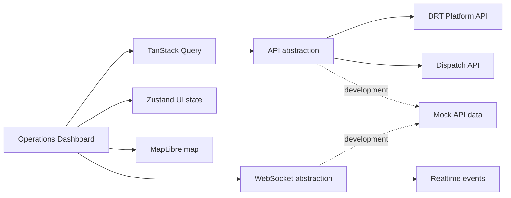

# Mawsel Operator Web

## Product Overview

Mawsel Operator Web is the control center for a Demand Responsive Transport (DRT) network. Dispatchers and fleet operations teams use it to see live vehicles, passenger trip requests, dispatch recommendations, service zones, incidents, and alert conditions in one workspace. The frontend presents decisions returned by the Dispatch Engine; it does not implement dispatch optimization algorithms.

## User Roles

- **Dispatcher**: monitor demand, review recommendations, assign or reassign trips, and resolve failed assignment alerts.
- **Fleet Manager**: manage fleet availability, maintenance, capacity, utilization, and driver-to-vehicle assignments.
- **Operations Manager**: supervise network performance, service zones, alerts, and operating configuration.
- **Support Agent**: inspect trip, passenger, driver, and incident context to support customers and operators.
- **Administrator**: manage users, permissions, operational configuration, and integrations.
- **Super Administrator**: cross-tenant and platform-level administration.

## Architecture

The App Router page renders a client-side operations dashboard. TanStack Query owns remote snapshot caching, Zustand contains small UI-only state, React Hook Form and Zod validate dispatch forms, and MapLibre renders the operational map. REST and realtime access are isolated behind the `lib` layer so mocks can be exchanged for production adapters without changing components.



## Technology Stack

- Next.js 16, React 19, TypeScript, Tailwind CSS 4
- TanStack Query, Zustand, React Hook Form, Zod
- MapLibre GL, Lucide icons
- Vitest, Playwright, ESLint, Prettier

## Project Structure

- `app/`: route entry point, global styles, Query provider
- `components/`: reusable operations UI and MapLibre map
- `lib/types.ts`: UI domain models aligned to platform and dispatch contracts
- `lib/api.ts`: production-facing API abstraction and contract endpoint map
- `lib/mock-api.ts`, `lib/mock-data.ts`: independent development REST and realtime mock layer
- `lib/store.ts`: UI-only global state

## Operations Workflows

The dashboard provides live network visibility for vehicles, statuses, drivers, active and unassigned trip requests, service zones, incidents, routes, and passenger pickups. Dispatchers use recommendations from `POST /api/v1/dispatch/optimize`, then create assignments through `POST /api/v1/dispatch` or the platform candidate endpoints. Manual reassignment is represented as a validated UI action; production wiring belongs in `lib/api.ts`.

Fleet and driver views support capacity, availability, utilization, maintenance, shifts, location, performance, and incidents. Zone administration supports the required zone, operating-hours, pickup, and drop-off management concepts. Analytics cards are designed for trip volume, wait time, P95 wait, utilization, cancellations, no-shows, unserved demand, kilometers, and heatmap inputs once backend metrics are available.

## API Contracts

The client models and endpoint registry align to:

- Platform API: `/Users/fasihul/Devs/mawsel/mawsel-drt-platform/openapi.yaml`
- Dispatch API: `/Users/fasihul/Devs/mawsel/mawsel-drt-dispatch/openapi.yaml`

Key endpoints include vehicles (`/api/v1/vehicles`), drivers (`/api/v1/drivers`), bookings (`/api/v1/bookings`), analytics (`/api/v1/analytics/dashboard`), and dispatch optimization/assignment (`/api/v1/dispatch/optimize`, `/api/v1/dispatch`). Configure a production adapter with `NEXT_PUBLIC_PLATFORM_API_URL` and `NEXT_PUBLIC_DISPATCH_API_URL`; the current adapter intentionally serves mock data.

## Realtime Architecture

`subscribeToRealtime` is the WebSocket-shaped boundary used by the dashboard. The mock emits vehicle, trip, driver, dispatch, and alert events every 15 seconds. Replace its interval with an authenticated socket connection, validate inbound events with Zod, apply updates to TanStack Query caches, and reconnect with exponential backoff.

## Map Architecture

The map is a client-only dynamic MapLibre import, avoiding server-side access to browser APIs. It visualizes vehicle markers and alert focus markers. A production map adapter should add service-zone polygons, vehicle routes, pickup/drop-off points, route-deviation geometry, clustering, viewport persistence, and token-scoped map styles.

## Security And Permissions

Authentication should use the organization identity provider with short-lived sessions. Enforce RBAC on the backend for every command; frontend role selection is presentation-only. Protect passenger and location data with least-privilege permissions, audit assignment and configuration actions, redact sensitive values from telemetry, and use TLS for API and WebSocket traffic.

## Testing

```bash
npm run lint
npm run test
npm run build
```

Vitest covers mock contract behavior. Playwright is included for browser workflow tests; add authenticated dispatcher, fleet, and incident workflows against a running app as backend environments become available.

## Observability

Instrument query failures, WebSocket reconnects, map load errors, command latency, recommendation acceptance/rejection, and alert acknowledgement. Emit structured logs with correlation IDs and avoid passenger-identifying fields. Surface frontend health through client error monitoring and operational dashboards.

## Deployment

Build with `npm run build` and deploy as a Next.js application. Supply API and map configuration through environment variables, use a CDN for static assets, and route API/WebSocket traffic through a TLS-enabled gateway. Deploy immutable artifacts and promote them through test, staging, and production with role-aware smoke tests.

## Roadmap

1. Replace mock REST and WebSocket adapters with authenticated production clients.
2. Add routed trip, fleet, driver, zone, analytics, configuration, and administration workspaces.
3. Implement backend-authorized command mutations with optimistic query updates and audit trails.
4. Add production map layers, geofencing, route playback, and demand heatmaps.
5. Add Playwright coverage for dispatcher and fleet operations workflows.